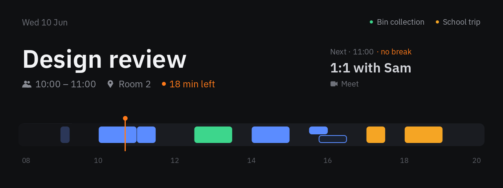
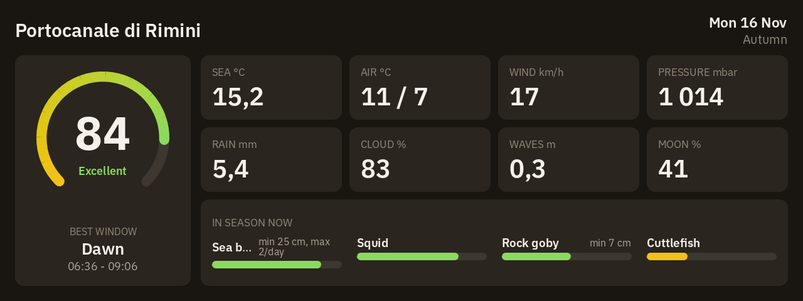
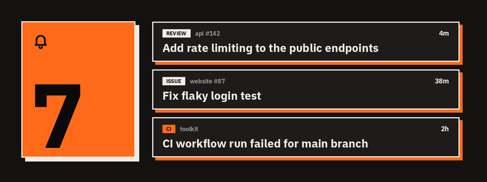
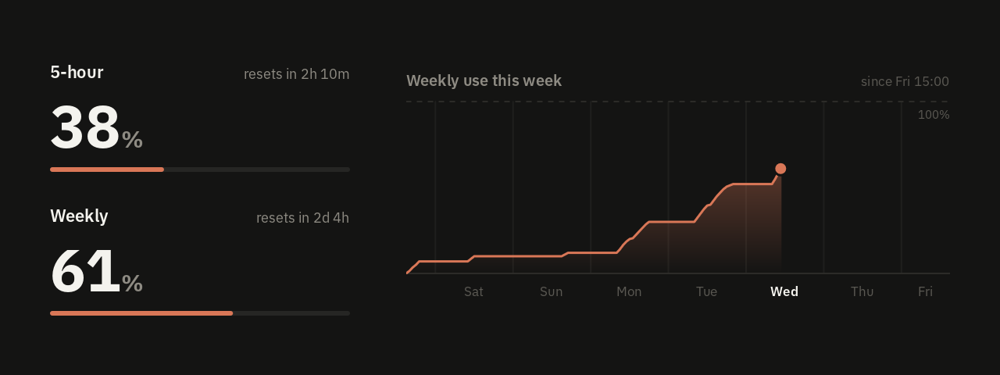

# Deck

Widgets for the [Braiins Deck](https://braiins.com) display, in one Rust workspace. Each widget compiles to WASM and installs from the Deck web UI as a `.nar` package.

No widget has personal data built in. Tokens go in Deck credential accounts. Addresses, calendars and spots go in the widget settings. All the screenshots below use sample data.

## Widgets

### [Calendar](widgets/calendar)

Today's events from the Google calendars that you choose. The current or next event is large at the top, and the full day is one line below it. Read-only access to Google Calendar.



### [Fishing Spot](widgets/fishing-spot)

The daily fishing index for a [dovepescare.com](https://dovepescare.com) spot that you choose: the score, the readings behind it, the best time window and the species in season. The same model as the site, with weather from Open-Meteo.



### [GitHub](widgets/github)

Your unread GitHub notifications. With none, the stars you received today, your followers and your top repo.



### [Claude Quota](widgets/claude-quota)

Your Claude plan use: the 5-hour and weekly limits with the time to reset, and the weekly use since the last reset. The data comes from a quota server on your LAN.



| Widget | Sizes | Connects to | Setup |
| --- | --- | --- | --- |
| [Calendar](widgets/calendar) | 1280 × 480, 638 × 480, 638 × 238, 317 × 238 | `oauth2.googleapis.com`, `www.googleapis.com` | Google OAuth token, calendar IDs |
| [Fishing Spot](widgets/fishing-spot) | 1280 × 480, 638 × 480, 638 × 238, 317 × 238 | `*.open-meteo.com` | Spot address from dovepescare.com |
| [GitHub](widgets/github) | 1280 × 480 | `api.github.com` | Classic token, `notifications` scope |
| [Claude Quota](widgets/claude-quota) | 1280 × 480 | Your quota server | Server address and read key |

## Install

1. Build and pack (see below), or use a `.nar` that you built before.
2. Deck web UI > Display Widgets > Install Widget. Select the `.nar` from `dist/`.
3. Add the widget to a scene, and fill in its settings. The setup for each widget is in its README.

To update a widget: increase `version` in its `manifest.json`, build, pack, and install the new `.nar`.

## Build

Requires rustup. `rust-toolchain.toml` installs Rust 1.99.1 with the `wasm32-unknown-unknown` target.

```
cargo build --release                         # all widgets
python3 tools/pack.py                         # all widgets: dist/<name>-<version>.nar
python3 tools/pack.py github                  # one widget (a folder name in widgets/)
cargo test --target aarch64-apple-darwin      # the tests run on the host
```

The SDK (`bmc-wasm-sdk`) is pinned in the root `Cargo.toml` to the 26.10.1 firmware release (WASM protocol 0.9). All widgets use the same pin. The release profile and the shared lints (from `bmc-main/widgets-wasm`) are also in the root `Cargo.toml`. All widgets must pass `cargo clippy --workspace -- -D warnings`.

## Screenshots

```
tools/screenshots.sh                          # writes docs/screenshots/<crate>-<shot>.png
```

1. Each widget has a host-only `src/preview.rs` with sample screens. Its `write_shots` test writes them as the encoded trees that the Deck would receive.
2. `tools/screenshots` draws the trees with the Deck's own renderer (`bmc-render` at the SDK rev), and saves one PNG per screen.

The script runs on macOS only, because it uses OpenGL through CGL. It needs rustup, git and curl. The first run checks out `bmc-main` at the SDK rev into `tools/screenshots/.bmc-main` (ignored by git), with the fonts and locale data that it keeps in Git LFS.

The sample data: made-up events, repos and quota values, and public Open-Meteo replies for two public dovepescare.com spots. The preview code is not in the `.wasm` that the Deck runs.

## Repo layout

```
Cargo.toml              workspace: SDK pin, release profile, lints
widgets/<folder>/       one crate per widget: manifest.json, assets/, src/, README.md
tools/pack.py           makes the .nar packages
tools/screenshots.sh    renders docs/screenshots/
tools/screenshots/      the renderer for the screenshots (its own workspace)
docs/screenshots/       the PNGs in the READMEs
```

## Add a widget

1. Make `widgets/<folder>/` with:
   - `Cargo.toml`: `crate-type = ["cdylib"]`, `bmc-wasm-sdk.workspace = true` and `[lints] workspace = true`. Do not add `"lib"` to `crate-type`: with two crate types, cargo turns off LTO for the `.wasm`.
   - `manifest.json`: a new `uid`, and `"binary": "bin/<name>"`. The `.nar` gets this name.
   - `assets/icon.svg` and `src/lib.rs`. Put `#[cfg(target_arch = "wasm32")]` on the glue only (polls, timers, storage, `render_ui`, the `extern "C"` exports), so that the screens also build on the host.
   - `src/preview.rs` (host only) with sample screens and the `write_shots` test, as in the other widgets.
   - `README.md` with these sections: an intro, `## Screens`, `## Data` (hosts, intervals, what stays on the Deck), `## Setup`, `## Build`, and `## Notes` if needed.
   - No personal values as defaults or in samples: no addresses, accounts or locations.
2. Build, pack, and run `tools/screenshots.sh`. The workspace, `tools/pack.py` and the screenshot script find the new folder.

## Licence

GPL-3.0-or-later, as set in each widget's `Cargo.toml`.
