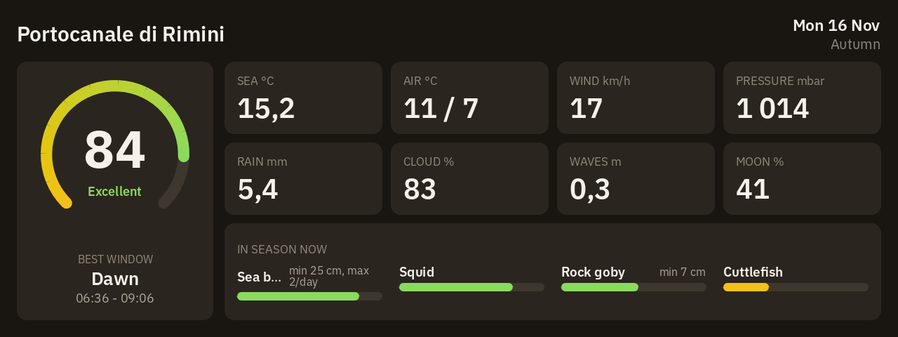
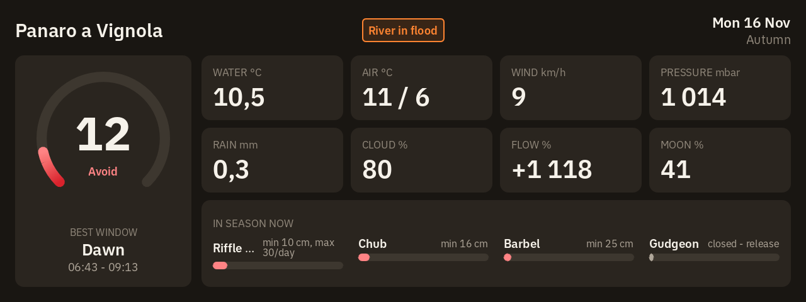
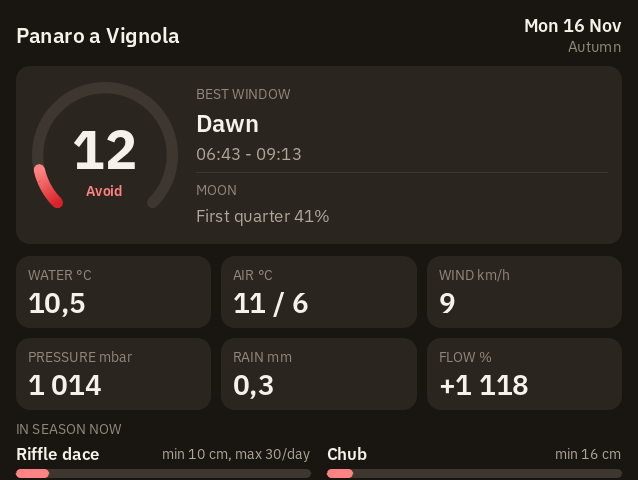
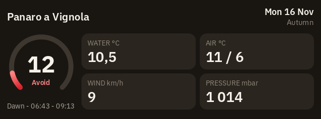
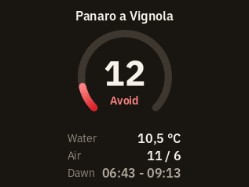

# Fishing Spot · Braiins Deck widget

Shows the daily fishing index of one spot from [dovepescare.com](https://dovepescare.com): a score from 0 to 100, the readings behind it, and the species in season. You choose the spot in the widget settings. The widget has no spot built in.

- The index uses the scoring model of dovepescare.com. For the same weather data, the widget gives the same number as the site.
- The catalogue has all 225 spots and 42 species of the site, with the regional and province rules.
- Water temperature: the measured sea surface on sea spots, an estimate from the air on all other waters.
- One reading changes with the water: FLOW (% against the median of the last weeks) on rivers and torrents, WAVES (m) on the sea, CLARITY (%) on the other waters.
- Warnings that cost score (closed season or ban, flood, storms, heavy rain, strong wind, rough sea) show as boxes in the header.
- Setting **Day**: Today or Tomorrow.
- Sizes:

  | Size | Shows |
  | --- | --- |
  | 1280 × 480 | gauge, best window, 8 readings, 4 species |
  | 638 × 480 | gauge, best window, moon, 6 readings, 2 species |
  | 638 × 238 | gauge, best window, 4 readings |
  | 317 × 238 | gauge, water, air, best window |

## Screens

A sea spot: the measured sea temperature and the waves replace the river flow.



A river spot on a day with a flood warning:



The smaller sizes: 638 × 480, 638 × 238 and 317 × 238.

<p>
  
  
  
</p>

The screens use the public Open-Meteo replies in `fixtures/` for two public catalogue spots. To make them again, see "Screenshots" in the [root README](../../README.md).

## Data

- It connects only to Open-Meteo, every 15 min:
  - `api.open-meteo.com`: the daily forecast, 14 days back and 7 days ahead.
  - `flood-api.open-meteo.com`: the river discharge. Rivers and torrents only.
  - `marine-api.open-meteo.com`: the sea temperature and waves. Sea spots only.
- It sends only the coordinates of the spot, or of the river model cell. No key, no account, no cookie. Open-Meteo sees the IP address of the Deck.
- It does not connect to dovepescare.com. The catalogue is in the widget.
- The Spot setting stays on the Deck.
- If the discharge or sea request fails, the index uses the estimate, as the site does.
- With no good forecast for about 25 min, the screen shows the time of the last data.

## Setup

1. Deck web UI > Display Widgets > Install Widget. Select `dist/fishing-spot-<version>.nar`.
2. Add the widget to a scene.
3. Widget settings > Spot: the spot address on dovepescare.com.
   - Open the spot page on the site. The address is the part after `/spot/`. For `https://dovepescare.com/spot/panaro-a-vignola/`, it is `panaro-a-vignola`.
   - You can also paste the full page address, or the spot id of the site data.
   - Until you set a spot, the widget shows "Add a spot in the widget settings". An address that it cannot find shows "Unknown spot: check the address".

## Build

From the repo root:

```
cargo test -p fishing-spot --target aarch64-apple-darwin
cargo clippy -p fishing-spot -- -D warnings
cargo build --release -p fishing-spot
python3 tools/pack.py fishing-spot
```

Output: `dist/fishing-spot-<version>.nar`. To update: increase `version` in `manifest.json`, build, and install the new `.nar`.

## Notes

### Source

The scoring model (`assets/js/engine.js`), the spots and the species come from dovepescare.com ([Turtlecute33/dove-pesco](https://github.com/Turtlecute33/dove-pesco)). This widget is not affiliated with the site. Weather data: [Open-Meteo](https://open-meteo.com), CC BY 4.0.

`src/engine.rs` is a port of `valuta()` in `engine.js`. It keeps the order of the operations, so the results agree to the last bits.

### Update the catalogue

The site changes its data and rules over time. To take the new data, use a checkout of dove-pesco. From the repo root:

```
node widgets/fishing-spot/tools/catalogue.mjs <path to dove-pesco>
node widgets/fishing-spot/tools/parity.mjs <path to dove-pesco>
cargo test -p fishing-spot --target aarch64-apple-darwin
```

- `catalogue.mjs` writes `src/catalogue.rs`. It keeps only the fields that the index and the faces use. It applies the province rules and the spot closures per spot and species. Only the date checks stay in the widget.
- `parity.mjs` computes the expected values with the real `engine.js` and writes them to `fixtures/`. Add `--refresh` to get new Open-Meteo data first. The fixtures are 8 spots of all water types (river, torrent, trout torrent, lake, canal, quarry lake, sea, a spot with a ban). Four of them are also moved to other dates, to test the trout opening, the October closure, summer time and June.
- The parity test (`src/engine/parity.rs`) needs the same index on every fixture day, and each value to within 1e-9.
- If `engine.js` changes, port the change to `src/engine.rs` until the parity test passes.

If `manifest.json` changes, make `src/manifest_params.rs` again with `bmc-widget-codegen`, from a `bmc-main` checkout at the rev in the root `Cargo.toml`:

```
cargo build -p bmc-widget-codegen --release
./target/release/bmc-widget-codegen --manifest <deck>/widgets/fishing-spot/manifest.json \
  --out <deck>/widgets/fishing-spot/src/manifest_params.rs
```

### Design

- Palette: warm, not neutral. `render/common.rs` sets its own greys with a little more red than blue (`#191612` ground, `#2A251F` panels, `#F6F2EA` text). Colour is only on the gauge, the species bars and the warnings.
- Tile readings are numbers only. The unit is in the caption (`WATER °C`, `PRESSURE mbar`). With the unit in the value, `1 013 mbar` did not fit a tile, the tile became two lines high, and the grid broke. A test in `display.rs` keeps every reading to 9 characters or less. A value that is too long gets an ellipsis.
- The header wraps the title in a `col`, so that the title and the date get the same flex share and the warnings stay in the centre. A flexed text node keeps its natural width as its basis; a flexed container starts from zero.
- The full face shows not more than 2 warnings, so that the spot name stays visible. Bonuses (such as "Recommended season here") change the index but do not show.
- Not shown, on purpose: a strip of the next days, the 72-hour rain (it is in the clarity model), the wind direction.
