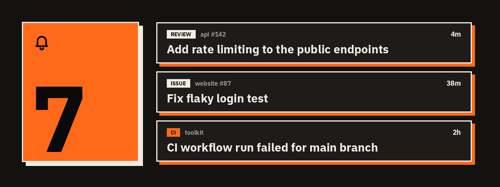
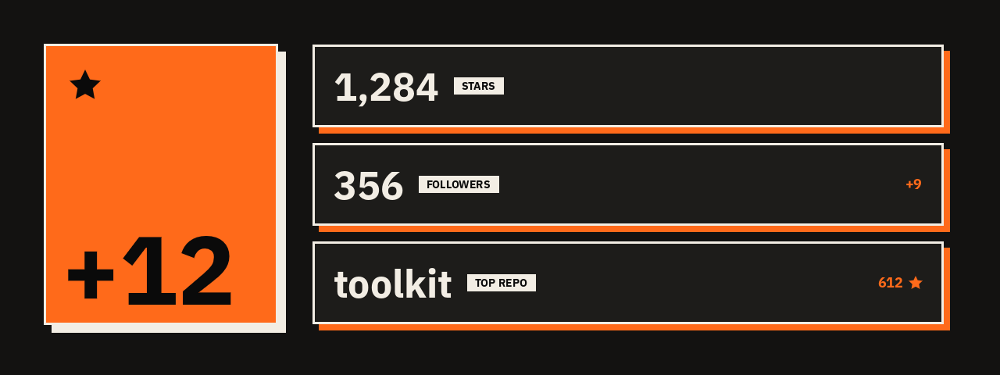

# GitHub · Braiins Deck widget

Shows your unread GitHub notifications: the count, and the newest three with type, repo and age. CI and security notifications have an orange label.

- With no unread notifications, it shows the stars you received today, your total stars, your followers (with the change over the last 7 days) and your top repo.
- Size: 1280 × 480 (full screen) only.

## Screens



With no unread notifications:



The screens use made-up repos and numbers. To make them again, see "Screenshots" in the [root README](../../README.md).

## Data

- It connects only to `api.github.com`.
- `GET /notifications` every 60 s (slower if GitHub asks for it). After an error, it tries again after 30 s.
- One GraphQL request every 15 min for the stars, the followers and the top repo.
- The token stays in the Deck credential account. The widget never sees it.
- With no good reply for 5 min, the screen dims and shows the time of the last data.

## Setup

1. GitHub > Settings > Developer settings > Personal access tokens > Tokens (classic) > Generate new token (classic).
   - Scope: `notifications`. Fine-grained tokens cannot read notifications.
   - If notifications from private repos do not show, add the `repo` scope. It gives full access to your repos, so add it only if you need it.
2. Deck web UI > Display Widgets > Install Widget. Select `dist/github-notify-<version>.nar`.
3. Add the widget to a scene as a full-screen widget.
4. Widget settings > GitHub token: add a generic token account with the token. Allow only `api.github.com`.

## Build

From the repo root:

```
cargo build --release -p github-notify
python3 tools/pack.py github
```

Output: `dist/github-notify-<version>.nar`. To update: increase `version` in `manifest.json`, build, and install the new `.nar`.

## Notes

- A full page of 50 notifications shows as "50+".
- The follower change needs one day of history. Until then, the widget shows no change.
- The stars of today are your total stars now less the first total after midnight (the Deck's time zone). The total updates every 15 min, so the count goes back to 0 up to 15 min after midnight. A star in those minutes, or while the Deck is off at midnight, does not count. A removed star decreases the count. After you install the widget, the count starts at 0.
- Since July 2026, GitHub shows who starred a repo, and when, only to tokens with write access to the repo. That is why the widget compares totals: the token needs only the `notifications` scope.
